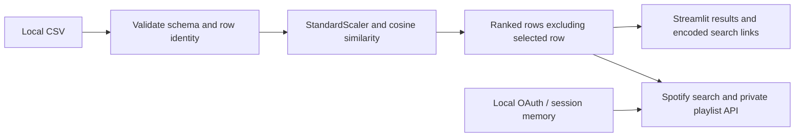

# Spotify music recommender

A local Streamlit application that ranks songs from a bundled CSV using
standardized audio features and cosine similarity. Spotify provides
account login, track search and private playlist creation. Audio features are
**not fetched live**, and the CSV is not the user's Spotify library.

## Setup (Python 3.12)

```sh
git clone https://github.com/MamilaGun23/Spotify-music-recommender-system.git
cd Spotify-music-recommender-system
python -m venv .venv
```

Activate with `.venv\Scripts\Activate.ps1` on Windows PowerShell or
`source .venv/bin/activate` on macOS/Linux, then:

```sh
python -m pip install -r requirements.txt
python -m streamlit run main.py --server.address 127.0.0.1
```

The login page starts without credentials. The UI requires login to continue;
the recommender itself can be tested offline. For real login, copy
`.env.example` to `.env` and set `SPOTIPY_CLIENT_ID`,
`SPOTIPY_CLIENT_SECRET`, and `SPOTIPY_REDIRECT_URI`. Register the identical
`http://127.0.0.1:8888/callback` URI in your Spotify developer application.
Never commit your values. Environment variables also work without a .env file.

The Streamlit port and OAuth callback port must differ. For a registered callback
of `http://127.0.0.1:8501/`, start the UI with
`python -m streamlit run main.py --server.address 127.0.0.1 --server.port 8502`.

OAuth opens a browser and loopback listener on the **machine running Streamlit**.
Use this as a local desktop application, one login at a time; the callback listener
is not a hosted multiuser authentication service. Login requests only
`playlist-modify-private`. Each login receives a new in-memory token cache;
logout clears the current Streamlit session's client and recommendation history.
Tokens may be refreshed by Spotipy during the session. Restarting the process
drops all in-memory state.

## Catalogue and data provenance

The existing `Recommender/songs_normalize.csv` contains track/artist labels and
audio-feature values. Its original publisher, collection process and redistribution
licence were not recorded in this repository and remain **unverified**. The MIT
code licence does not establish rights to the data; confirm attribution and data
rights before redistribution or public deployment. No data source or licence has
been invented here.

To use your own CSV, set `SONGS_CSV_PATH` in .env or the environment. Relative
paths resolve from the repository root, independently of the working directory.
Required columns: `song`, `artist`, and all of:

```text
danceability energy key loudness mode speechiness acousticness
instrumentalness liveness valence tempo
```

Labels must be nonempty and features finite numeric values. Invalid/missing values
are rejected with a recoverable error; they are not silently replaced with zeros.
Duration, year, popularity and numeric identifiers are excluded. Key and mode
remain numeric signals for compatibility with the original method; this treatment
of musical categories is a modelling limitation.

Rows receive a unique `row_id` (their CSV position). Dropdowns include title,
artist and row ID, so duplicate titles and repeated recordings are distinguishable.
Rows are never deduplicated by artist. StandardScaler fits the whole catalogue
for retrieval, not a supervised train/test evaluation. The selected row is removed
before sorting; equal scores retain CSV order. Requests larger than the catalogue
return all available alternatives.

## Data flow



Playlist creation searches by track and artist and uses the first Spotify result;
a result may be a different recording. All tracks must resolve before a playlist
is created. Tracks are added in batches of 100. A later API failure can leave a
partial playlist; inspect your account before retrying. Spotify permissions,
account eligibility and API availability can prevent these operations.

## Actual layout

```text
main.py                    Streamlit entry point
Recommender/
  __init__.py              Package marker
  auth.py, login.py        Local OAuth and session lifecycle
  data.py, features.py     CSV path and explicit schema
  recommend.py             Retrieval, stable IDs and encoded links
  playlist_utils.py        Spotify search and private playlist operations
  ui.py, analytics.py      Interface and descriptive catalogue analysis
  songs_normalize.csv      Existing catalogue (provenance unverified)
pages/analytics.py         Streamlit analytics page
scripts/check_login.py     Optional manual account check
scripts/check_live.py      Opt-in live refresh/search/playlist verification
tests/                     Offline regression and app startup tests
requirements.txt           Runtime dependencies
requirements-dev.txt       Runtime plus test/lint tools
.env.example               Dummy configuration
```

## Offline verification

```sh
python -m pip install -r requirements-dev.txt
python -m pytest -q
python -m ruff check .
python -m compileall -q Recommender pages main.py scripts tests
```

Tests mock Spotify and cover duplicate identities, exact self-exclusion, malformed
and short datasets, missing/nonfinite features, tie ordering, URL encoding, token
isolation, logout, playlists and Streamlit startup. Transport tests use the real
pinned Spotipy client with HTTP intercepted, checking current endpoints, JSON
request bodies and 100-item batch boundaries. They require no credentials
or Spotify network access. For an intentional live account check only, run
`python -m scripts.check_login`; this opens the local OAuth browser and checks
the account profile and a real catalogue-track search. It does not create a
playlist. Missing configuration is reported as BLOCKED, never as a live pass.

Playlist creation uses the authenticated-current-user endpoint rather than the
removed user-specific endpoint (see [Spotify's migration guide](https://developer.spotify.com/documentation/web-api/tutorials/february-2026-migration-guide)).
An explicit request adapter supplies the documented JSON object for additions,
because Spotipy 2.26.0's public add-items helper serializes a bare array. See the
[add-items API reference](https://developer.spotify.com/documentation/web-api/reference/add-items-to-playlist).

See [REMEDIATION.md](REMEDIATION.md) for actual observed validation results.
See [LIVE_VERIFICATION.md](LIVE_VERIFICATION.md) for the successful live-account
check and its limits. To repeat read-only live checks, run
`python -m scripts.check_live`; add `--playlist` to create and retain one diagnostic
playlist, verify addition acknowledgements, and attempt to read its tracks back.
This opens Spotify's browser consent page and requires your own credentials.
There is no verified deployment, benchmark, recommendation-accuracy measurement,
collaborative filtering or live audio-feature ingestion.
